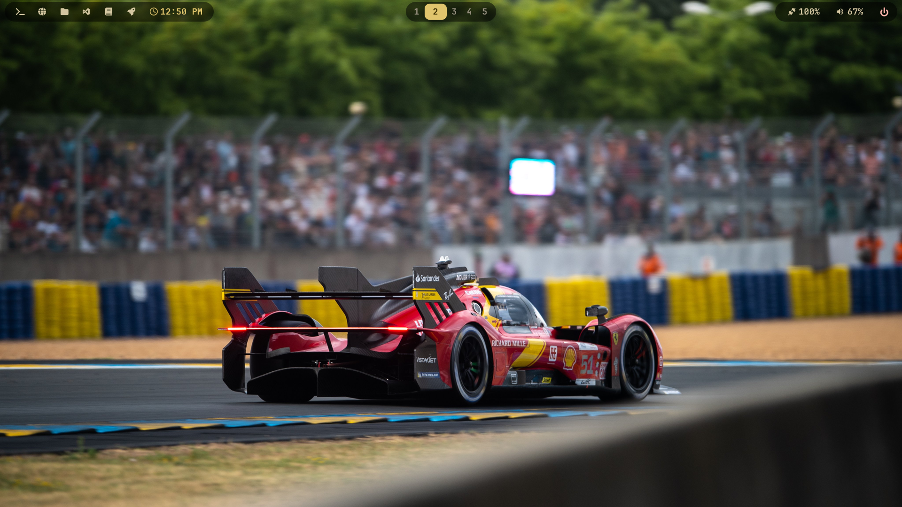
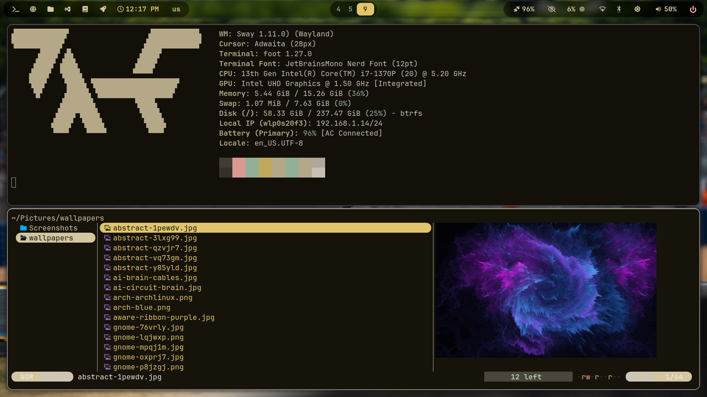
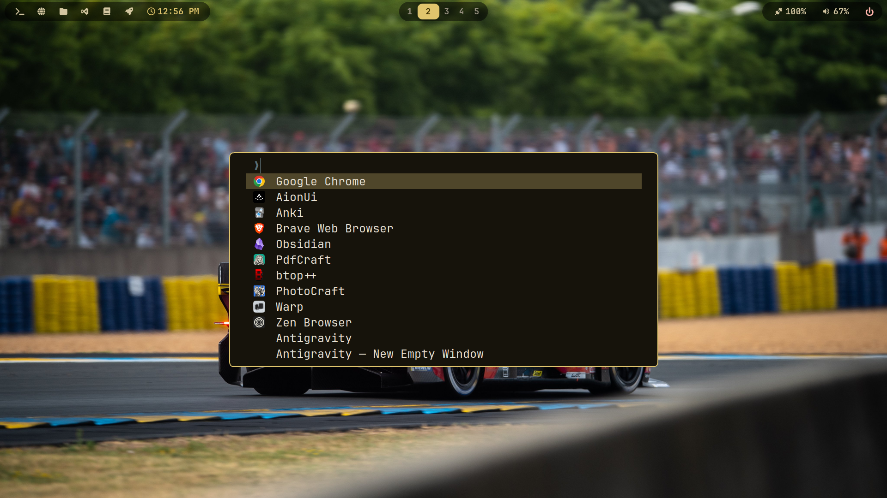
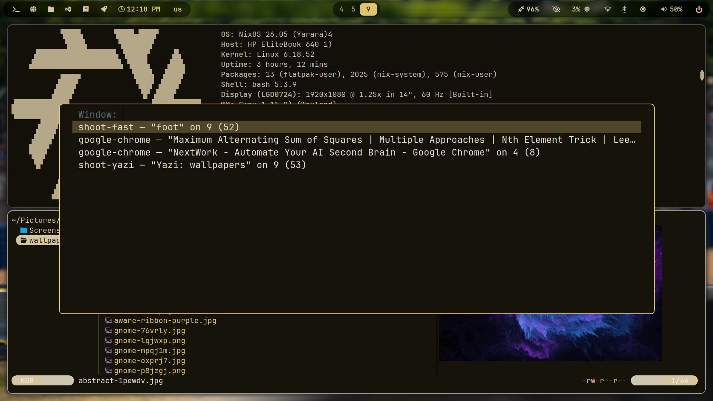
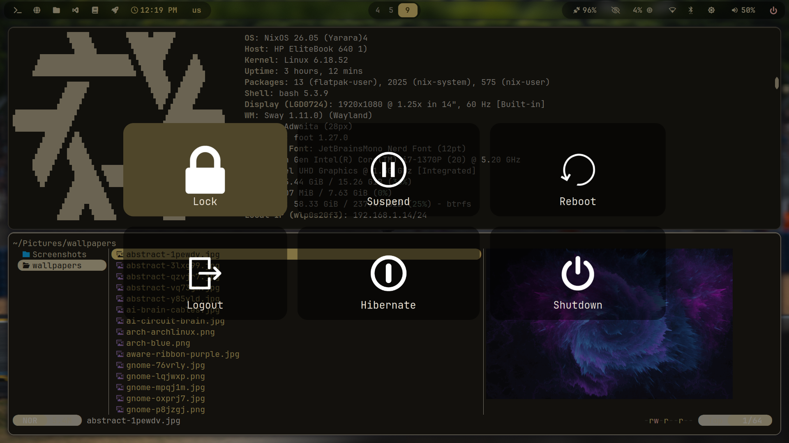
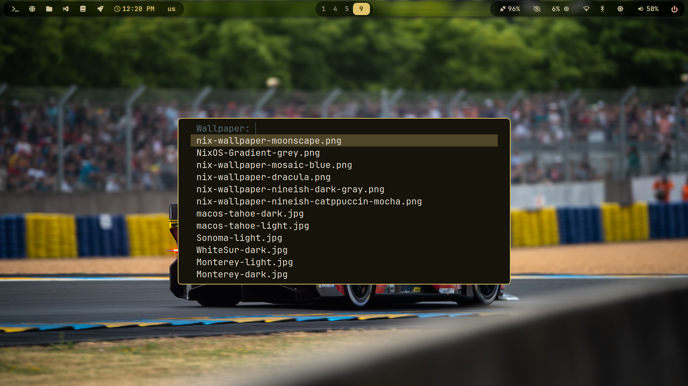
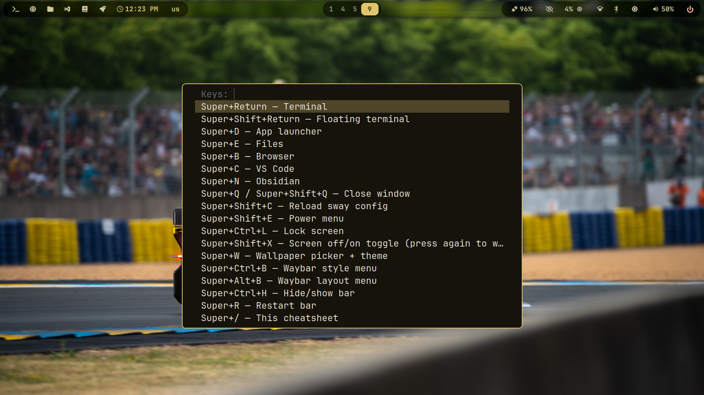

# sway_setup — Catppuccin Mocha Sway rice on NixOS

My daily-driver Sway setup: SwayFX + islands-style Waybar, wallpaper-driven
theming (matugen), 12 workspaces, 50-wallpaper collection, Flatpak creative apps,
and a full recording setup for tech content. Built on NixOS 26.05 alongside GNOME.

## Screenshots

| | | |
|---|---|---|
| <br>**Desktop** — islands bar, `us` layout flag, race wallpaper | <br>**Tiled session** — fastfetch + yazi wallpaper library | <br>**Launcher** — fuzzel drun (`Super+D`) |
| <br>**Switcher** — swayr across workspaces (`Alt+Tab`) | <br>**Power menu** — wlogout (`Super+Shift+E`) | <br>**Wallpaper picker** — auto-theme (`Super+W`) |
| | <br>**Cheatsheet** — every shortcut (`Super+/`) | |

## Quick reinstall

```bash
git clone https://github.com/bmo1177/sway_setup.git
cd sway_setup
./install.sh
```

The script backs up your current `~/.config` pieces (timestamped), installs
everything from `config/`, installs `sway-inhibit-toggle` to `~/.local/bin`,
repairs the Waybar `config`/`style.css` symlinks, creates
`~/Pictures/wallpapers` + `~/Pictures/Screenshots`, checks runtime binaries,
and prints the remaining manual steps (NixOS packages + rebuild, user tools,
Flatpaks, re-login).

Restore a backup: `cp -a ~/.config-backup-<timestamp>/<name> ~/.config/<name>`

## What's inside

| Area | Details |
|---|---|
| Compositor | SwayFX 0.5.3 (blur, shadows, rounded corners), 14" 1080p @ 1.25 scale via kanshi |
| Theme | Catppuccin Mocha everywhere; `Super+W` picker recolors bar, terminal, launcher, GTK from the wallpaper |
| Bar | Waybar islands: 6 quick launchers, numbered workspaces 1–12, layout flag (us/ara, click to switch), notify drawer, system drawer (cpu/mem/temp), network, audio drawer, idle-inhibit icon, power |
| Notifications | swaync (themed, canonical, blurred layer) · mako config kept as unused fallback · Power menu: wlogout (themed) |
| Launcher | fuzzel (drun, clipboard history, wallpaper picker, cheatsheet) |
| Extras | Alt+Tab + Super+Tab window switchers (swayr), focus mode, keystroke overlay (wshowkeys), night light (gammastep), lid-close lock, smart gaps |
| Apps | OBS Studio, Kdenlive, FilmCraft, PhotoCraft, PdfCraft (Flatpaks), Obsidian, Warp, VS Code |
| Recording | OBS (RNNoise mic filter built in, wlr portal for Wayland capture), Super+Shift+R region clips, swappy annotate, color picker |

## Repo layout

```
config/        # dotfiles, mirrored 1:1 to ~/.config/ (sway, waybar, foot,
               #   fuzzel, swaync, wlogout, swayr, matugen, mako, kanshi,
               #   gammastep, fontconfig)
               # Waybar: config -> configs/bintang-default,
               #         style.css -> styles/islands.css (relative symlinks).
               # Switch with Super+Ctrl+B (style) / Super+Alt+B (layout).
nixos/         # sway.nix — full importable module;
               # sway-binnewbs-snippet.nix — minimal paste-in fragment
```

Wallpapers live in `~/Pictures/wallpapers/` (50 and counting, not vendored here).
`~/.config/sway/current_wallpaper` is a symlink (never committed, gitignored).

## Install on NixOS

1. System packages — either import the module:
   ```nix
   imports = [ /path/to/sway_setup/nixos/sway.nix ];
   ```
   or paste `nixos/sway-binnewbs-snippet.nix` into
   `programs.sway.extraPackages` in `/etc/nixos/configuration.nix`, then:
   ```bash
   sudo nixos-rebuild switch
   ```
2. Install dotfiles (backs yours up first — do NOT `cp -r` by hand):
   ```bash
   ./install.sh
   ```
3. Log out → pick **Sway** at the login screen → log back in.
4. Flatpaks: `flatpak remote-add --user flathub https://dl.flathub.org/repo/flathub.flatpakrepo`,
   then install the `.flatpak` bundles from each app's GitHub releases.
5. `Super+W` picks wallpaper + theme (or restores `current_wallpaper` at login
   via `sway-wallpaper --apply`). `Super+/` shows every shortcut.
6. Rebuild notes: `swww` was renamed to `awww` in nixpkgs; Kdenlive lives at
   `kdePackages.kdenlive`; `matugen image` is broken in 4.0.0 — this setup works
   around it (ffmpeg average color → `matugen color`, see `config/sway/scripts/sway-wallpaper`).

### Window placement

No `assign` rules — Firefox, Brave, and Chrome all open on whichever
workspace you are on, so links stay put.

## Troubleshooting

- `sway -C -c ~/.config/sway/config` validates the sway config.
- `python3 -m json.tool ~/.config/waybar/config` validates the Waybar JSON.
- Missing binary warnings from `./install.sh` → rebuild with `nixos/sway.nix`.
- Double Waybar after reload → `Super+R` (`waybar-restart` kills `-wrapped` binaries correctly).
- `swayrd` socket stale → Alt+Tab/Super+Tab self-heal and restart the daemon.
- No wallpaper at login → drop images in `~/Pictures/wallpapers`, press `Super+W`.

## Keybindings (`Super` = Windows key, full list on `Super+/`)

| Keys | Action |
|---|---|
| Super+Return / D / E / B / C / N | Terminal / launcher / Files / browser / Code / Obsidian |
| Super+Q, Super+F, Super+Shift+F | Close / fullscreen / focus mode (fullscreen + hide bar) |
| Super+1..0, Super+F11/F12 | Workspaces 1–12 (Shift moves windows) |
| Alt+Tab, Super+Tab | Window / workspace switcher |
| Super+W | Wallpaper picker + auto-theme |
| Super+Shift+E / Super+L | Power menu / lock |
| Super+Shift+X | Screen off/on toggle |
| Super+I | Keystroke overlay (recordings) |
| Super+O | Idle-inhibit toggle (`~/.local/bin/sway-inhibit-toggle`) |
| Super+Minus / Super+Shift+Minus | Scratchpad show / send to scratchpad |
| Print / Super+Print / Super+Shift+S | Screenshots (region/file/annotate) |
| Ctrl+Print | Region screenshot to clipboard |
| Super+Shift+R | Region screen recording (toggle to stop, `~/Videos/screencasts/`) |
| Super+Ctrl+C | Color picker (copies hex) |
| Super+Ctrl+V | Clipboard history |

## Credits

Binnewbs/arch-hyprland and JaKooLit for the rice ideas; Catppuccin, SwayFX,
Waybar, swaync, wlogout, fuzzel, matugen, awww, swayr, ArtCraft crew.
